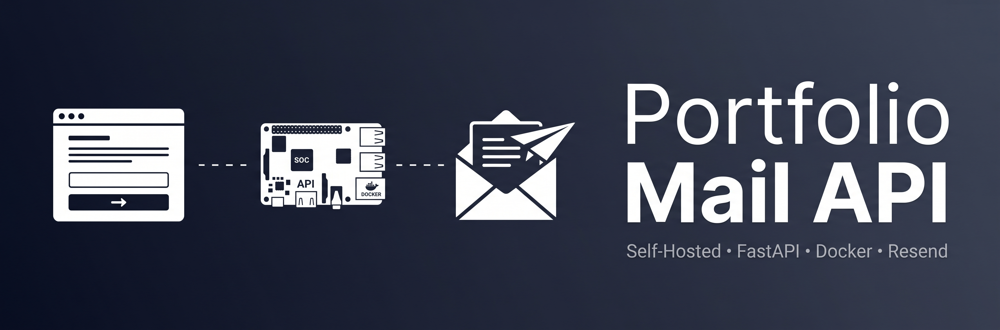

<div align="center">
  
  
  
  <br><br>

  <p>
    
    
    
    
    
  </p>
  <br>
</div>

---

Microservicio backend desarrollado con **Python 3.11 y FastAPI**, diseñado exclusivamente para recibir peticiones `POST` provenientes de un formulario de contacto web y despachar los mensajes mediante la **API de Resend**.

La aplicación se ejecuta de forma contenerizada en infraestructura **self-hosted ARM64**, con despliegue persistente mediante Docker Compose y exposición pública a través de **Cloudflare Tunnel**.

---

## Arquitectura de despliegue

```text
 ┌───────────────────────┐
 │      Sitio Web        │
 │    tudominio.com      │
 └──────────┬────────────┘
            │
            │ HTTPS
            ▼
┌────────────────────────────┐
│      Cloudflare Edge       │
│                            │
│   • Cloudflare Tunnel      │
│   • WAF                    │
│   • Rate Limiting          │
└────────────┬───────────────┘
             │
             ▼
┌────────────────────────────┐
│       Homelab ARM64        │
│                            │
│       Docker Compose       │
│             │              │
│             ▼              │
│  ┌──────────────────────┐  │
│  │   Portfolio Mail API │  │
│  │       FastAPI        │  │
│  └──────────┬───────────┘  │
└─────────────┼──────────────┘
              │
              │ HTTPS API
              ▼
       ┌──────────────┐
       │    Resend    │
       └──────┬───────┘
              │
              ▼
       ┌──────────────┐
       │ Destinatario │
       └──────────────┘
```

### Flujo de la petición

1. El usuario completa el formulario de contacto del sitio web.
2. El frontend realiza una petición `POST` al endpoint `/api/contact`.
3. FastAPI valida la estructura recibida mediante Pydantic.
4. La API construye el contenido del correo.
5. Resend procesa el envío utilizando la API configurada mediante variables de entorno.
6. La respuesta de Resend se devuelve al cliente.

La API no gestiona autenticación de usuarios ni almacenamiento de mensajes. Su función está limitada al procesamiento y despacho del formulario de contacto.

---

## Características de seguridad

### CORS restringido

El middleware `CORSMiddleware` utiliza un único origen permitido definido mediante la variable:

```env
ALLOWED_ORIGIN=https://tudominio.com
```

Además, la política permite únicamente:

* Método `POST`
* Header `Content-Type`
* Credenciales habilitadas

No se utiliza un comodín (`*`) para los orígenes.

### Validación mediante Pydantic

El endpoint recibe exclusivamente estructuras que cumplen con el modelo:

```text
ContactForm
├── nombre
├── apellido
├── email
└── mensaje
```

FastAPI y Pydantic validan automáticamente el cuerpo de la petición antes de ejecutar la lógica de envío.

### Documentación deshabilitada en producción

Cuando:

```env
ENV=production
```

la aplicación desactiva automáticamente:

```text
/docs
/redoc
/openapi.json
```

En entornos de desarrollo estas rutas permanecen disponibles para facilitar las pruebas de la API.

### Gestión de secretos

Las credenciales y configuraciones sensibles se cargan mediante variables de entorno y un archivo `.env`.

El archivo `.env` no debe formar parte del repositorio.

El repositorio únicamente incluye:

```text
.env.example
```

como plantilla de configuración.

Variables utilizadas:

```env
ENV=production

RESEND_API_KEY=tu_api_key_aqui

EMAIL_CONTACT=tu_correo_personal@gmail.com
EMAIL_FROM=Portafolio <formulario@tudominio.com>

ALLOWED_ORIGIN=https://tudominio.com
```

### Protección perimetral

El servicio se publica mediante **Cloudflare Tunnel**, evitando la exposición directa de la infraestructura mediante port-forwarding.

La capa perimetral utiliza:

* **Cloudflare WAF**
* **Rate Limiting**
* Límite configurado de **5 peticiones**

Estas medidas se aplican antes de que las solicitudes alcancen el servicio FastAPI.

---

## Stack tecnológico

| Componente            | Tecnología                     |
| --------------------- | ------------------------------ |
| Lenguaje              | Python 3.11                    |
| Framework             | FastAPI                        |
| Servidor ASGI         | Uvicorn                        |
| Validación            | Pydantic                       |
| Envío de correo       | Resend API                     |
| Variables de entorno  | python-dotenv                  |
| Contenedores          | Docker                         |
| Orquestación          | Docker Compose                 |
| Infraestructura       | Raspberry Pi / ARM64           |
| Exposición pública    | Cloudflare Tunnel              |
| Protección perimetral | Cloudflare WAF + Rate Limiting |

---

## Endpoint

### `POST /api/contact`

Recibe los datos enviados desde el formulario de contacto.

### Payload

```json
{
  "nombre": "Nombre",
  "apellido": "Apellido",
  "email": "usuario@example.com",
  "mensaje": "Mensaje enviado desde el formulario."
}
```

### Respuesta exitosa

```json
{
  "status": "success",
  "message": "Correo enviado con éxito."
}
```

La API utiliza el correo recibido en `email` como dirección de respuesta (`reply_to`) y entrega el mensaje al destinatario definido mediante `EMAIL_CONTACT`.

---

## Requisitos previos

Para ejecutar el proyecto se requiere:

* Docker
* Docker Compose
* Cuenta de [Resend](https://resend.com/)
* API Key de Resend
* Un dominio configurado para el frontend
* Cloudflare Tunnel para la publicación del servicio en producción

La infraestructura de producción utilizada está basada en **ARM64**, por lo que la imagen emplea `python:3.11-slim`, compatible con esta arquitectura.

---

## Despliegue local

### 1. Clonar el repositorio

```bash
git clone https://github.com/NarcisoIn/portfolio-mail-api.git
cd portfolio-mail-api
```

### 2. Crear el archivo `.env`

Copiar la plantilla:

```bash
cp .env.example .env
```

Editar las variables de entorno:

```env
ENV=production

RESEND_API_KEY=tu_api_key_aqui

EMAIL_CONTACT=tu_correo_personal@gmail.com
EMAIL_FROM=Portafolio <formulario@tudominio.com>

ALLOWED_ORIGIN=https://tudominio.com
```

### 3. Construir y ejecutar

```bash
docker compose up -d
```

Para comprobar el estado del servicio:

```bash
docker compose ps
```

Para consultar los logs:

```bash
docker compose logs -f
```

Para detener el servicio:

```bash
docker compose down
```

---

## Estructura del proyecto

```text
portfolio-mail-api/
├── main.py
├── requirements.txt
├── Dockerfile
├── docker-compose.yml
├── .env.example
└── .gitignore
```

---

## Docker

La imagen está basada en:

```dockerfile
FROM python:3.11-slim
```

El contenedor instala las dependencias definidas en `requirements.txt` y ejecuta la aplicación mediante Uvicorn.

El servicio se mantiene activo mediante la política:

```yaml
restart: unless-stopped
```

La configuración sensible se proporciona externamente mediante:

```yaml
env_file:
  - .env
```

De esta forma, las credenciales no forman parte de la imagen ni del código fuente versionado.

---

## Variables de entorno

| Variable         | Descripción                                         |
| ---------------- | --------------------------------------------------- |
| `ENV`            | Entorno de ejecución (`production` o `development`) |
| `RESEND_API_KEY` | API Key utilizada para autenticarse con Resend      |
| `EMAIL_CONTACT`  | Destinatario de los mensajes del formulario         |
| `EMAIL_FROM`     | Remitente utilizado para los correos                |
| `ALLOWED_ORIGIN` | Origen permitido para las peticiones CORS           |

---

## Dependencias principales

```text
fastapi
uvicorn
pydantic
python-dotenv
resend
```

Las versiones exactas se encuentran fijadas en `requirements.txt` para mantener un entorno reproducible.

---

## Producción

La arquitectura de producción separa las responsabilidades entre la aplicación y la capa perimetral:

```text
Frontend
   │
   ▼
Cloudflare
   │
   ├── WAF
   ├── Rate Limiting
   └── Tunnel
        │
        ▼
     FastAPI
        │
        ▼
      Resend
```

El backend permanece dentro del homelab y no requiere exposición directa de la infraestructura hacia Internet.

La configuración `ENV=production` deshabilita la documentación interactiva de FastAPI, mientras que las credenciales permanecen fuera del repositorio.

---

## Licencia

Este repositorio puede distribuirse bajo la licencia definida en el archivo `LICENSE`.
